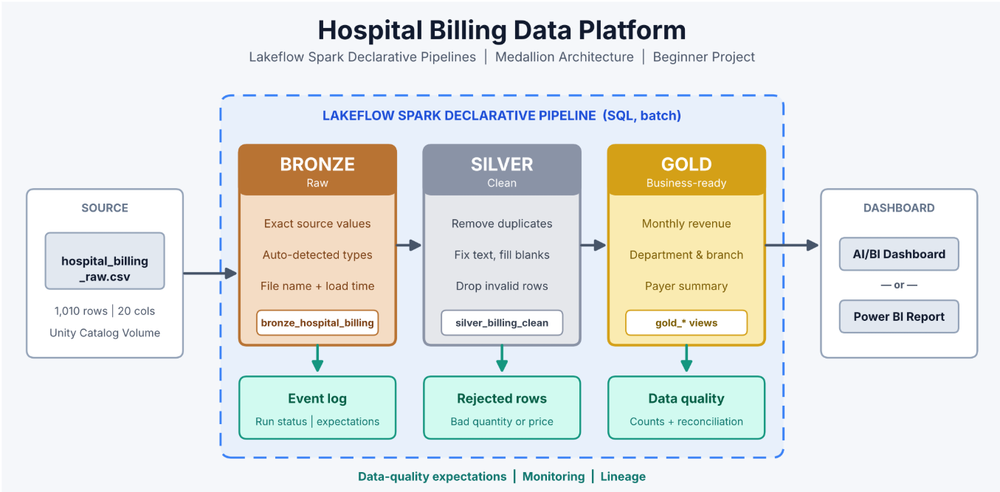

# Hospital Billing Analytics Platform: Medallion Architecture with Lakeflow Spark Declarative Pipelines

An end-to-end hospital billing data engineering project on **Azure Databricks**, built with **Lakeflow Spark Declarative Pipelines (SQL)** and the **Medallion Architecture** (Bronze → Silver → Gold). It transforms a synthetic hospital billing CSV into cleaned, validated, business-ready summary tables for revenue, departments, branches, and payer analysis.



## Table of Contents
- [Business Problem](#business-problem)
- [Architecture](#architecture)
- [Pipeline Lineage](#pipeline-lineage)
- [Tech Stack](#tech-stack)
- [Dataset](#dataset)
- [Repository Structure](#repository-structure)
- [Layer Details](#layer-details)
- [Data Quality Rules](#data-quality-rules)
- [Reconciliation](#reconciliation)
- [How to Run](#how-to-run)
- [Business Requirements Coverage](#business-requirements-coverage)
- [Key Learnings](#key-learnings)
- [Future Improvements](#future-improvements)

## Business Problem
A hospital chain operates six branches across three regions of India and exports patient billing records to CSV. Monthly reporting is slow and unreliable because the source contains inconsistent text formatting, blank values, duplicate bill lines, and invalid quantities or prices.

**Goal:** build a repeatable pipeline that preserves the source data, cleans and validates billing records, produces trusted Gold-layer summaries, and makes the results available through a dashboard.

## Architecture
`hospital_billing_raw.csv` (Unity Catalog Volume) → **Bronze** (raw, traceable) → **Silver** (clean + rejected) → **Gold** (business summaries + data quality) → Databricks AI/BI or Power BI dashboard

| Layer | Purpose | Key actions |
|-------|---------|-------------|
| Bronze | Preserve source data | Load the CSV without changing business values; add source file and load timestamp |
| Silver | Improve data trust | Remove duplicate bill lines, standardize text, handle blanks, derive missing totals, separate invalid records |
| Gold | Answer business questions | Aggregate monthly revenue, department, branch and payer metrics; summarize data-quality issues |
| Dashboard | Communicate results | Present business KPIs, operational comparisons and data-quality status |

## Pipeline Lineage
The intended pipeline contains one Bronze streaming table, two Silver materialized views, and five Gold materialized views.

| Object | Type | Description |
|--------|------|-------------|
| `bronze_hospital_billing` | Streaming table | Raw hospital billing records with ingestion metadata |
| `silver_billing_clean` | Materialized view | Deduplicated, standardized and valid billing records |
| `silver_billing_rejected` | Materialized view | Records rejected for invalid quantity or negative unit price, with a reason |
| `gold_monthly_revenue` | Materialized view | Monthly visits, total revenue and insurance amount |
| `gold_department_summary` | Materialized view | Visits, bills, revenue and average revenue per visit by department |
| `gold_branch_summary` | Materialized view | Visits and revenue by region, city and hospital branch |
| `gold_payer_summary` | Materialized view | Visits, revenue, insurance amount and pending amount by payer |
| `gold_data_quality` | Materialized view | Source issue counts, clean/rejected counts and reconciliation metrics |

## Tech Stack
- Azure Databricks
- Lakeflow Spark Declarative Pipelines (SQL)
- Unity Catalog (Volumes)
- Delta Lake
- Databricks SQL
- Databricks AI/BI or Power BI (choose one dashboard option)

## Dataset
The project uses a **synthetic hospital billing dataset** named `hospital_billing_raw.csv`, containing **1,010 rows and 20 columns** representing **330 patient visits in 2025**. It contains no real patient data.

The grain is **one bill line per row**. `bill_id` is expected to be unique for each bill line; `visit_id` is not unique because a visit can contain multiple bill lines.

The dataset includes patient and visit attributes, hospital/service details, billing amounts, insurance amounts and payment status. Intentionally planted data-quality issues include extra spaces, inconsistent capitalization, blank values, duplicate bill IDs, zero or negative quantities, and negative prices.

## Repository Structure
```text
├── README.md
├── data/                         # synthetic source dataset
├── pipeline/
│   ├── bronze/                   # Bronze ingestion SQL
│   ├── silver/                   # Silver cleaning and rejected-record SQL
│   └── gold/                     # Gold business and data-quality SQL
├── validation/                   # reconciliation and validation queries
├── docs/                         # project and data-quality documentation
└── images/                       # architecture, pipeline and dashboard screenshots
```

## Layer Details

### Bronze
- Reads `hospital_billing_raw.csv` from a Unity Catalog Volume.
- Preserves the source records for traceability.
- Adds ingestion metadata such as `source_file` and `loaded_at`.
- The project brief expects 1,010 rows in Bronze after ingestion.

Example source location from the project brief:
`/Volumes/healthcare_catalog/billing/raw_files/`

### Silver
- Uses `SELECT DISTINCT` to remove duplicate bill lines based on the source's stated `bill_id` uniqueness rule.
- Trims whitespace and standardizes text using `TRIM` and `INITCAP`.
- Replaces blank or null department and payer values with `Unknown`.
- Calculates a missing `total_amount` as `quantity * unit_price`.
- Retains a blank patient ID because the bill can still be valid for revenue analysis.
- Applies Lakeflow expectations to reject rows with `quantity <= 0` or `unit_price < 0`.
- Stores invalid records in `silver_billing_rejected` with a rejection reason.

### Gold
- `gold_monthly_revenue`: monthly visits, total revenue and insurance amount.
- `gold_department_summary`: department-level visits, bill count, revenue and average revenue per visit.
- `gold_branch_summary`: branch, city and region performance.
- `gold_payer_summary`: payer-level revenue, insurance amount and pending amount.
- `gold_data_quality`: counts of source issues and layer-level reconciliation metrics.

## Data Quality Rules
| Rule | Treatment |
|------|-----------|
| Duplicate bill lines | Keep one copy of each bill line; `bill_id` is the uniqueness key |
| Text standardization | Apply `TRIM` and `INITCAP` to relevant text columns |
| Missing department | Replace with `Unknown` |
| Missing payer type | Replace with `Unknown` |
| Missing total amount | Derive as `quantity * unit_price` |
| Missing patient ID | Retain the row; patient ID is not required for valid billing revenue |
| Invalid quantity | Reject rows where `quantity <= 0` and retain a rejection reason |
| Negative unit price | Reject rows where `unit_price < 0` and retain a rejection reason |

Details: [`Docs/data_quality_rules.md`](Docs/data_quality_rules.md)

## Reconciliation
The project brief defines the reconciliation condition as:

`Bronze rows = clean rows + rejected rows + duplicate rows removed`

The quality summary should make the source count, duplicate count, invalid quantity/price counts, missing-value counts, clean count and rejected count visible. Make sure the implementation uses mutually exclusive accounting buckets so a row is not counted twice (for example, as both a duplicate and a rejected row).

**Expected source baseline:** 1,010 rows in Bronze. Actual clean, rejected, duplicate and reconciliation results must be populated from the completed pipeline run; they are not specified in the project brief.

Validation queries: [`validation/`](validation/)  
Reconciliation notes: [`Docs/reconciliation.md`](docs/reconciliation.md)

## How to Run
1. Create or select a Unity Catalog catalog and schema. The project brief uses `healthcare_catalog.billing`.
2. Create a Volume for source files, for example `healthcare_catalog.billing.raw_files`.
3. Upload `hospital_billing_raw.csv` to the Volume.
4. Create a **Lakeflow Spark Declarative Pipeline**, set its default catalog and schema, and add the SQL files from `pipeline/`.
5. Configure the Bronze source path to the uploaded CSV location.
6. Start the pipeline and verify that the Bronze table contains the expected 1,010 source rows.
7. Check the Silver clean and rejected views and review the rejection reasons.
8. Query the Gold tables and run the reconciliation checks in `validation/`.
9. Build one dashboard using either Databricks AI/BI or Power BI. The dashboard should contain the three pages described in the project brief.

The project brief gives this example Volume path:
`/Volumes/healthcare_catalog/billing/raw_files/`

## Business Requirements Coverage
| ID | Requirement | Gold object / evidence |
|----|-------------|------------------------|
| BR-01 | Monthly revenue: revenue, insurance amount and visits by month | `gold_monthly_revenue` |
| BR-02 | Department performance: revenue, visits and average revenue per visit | `gold_department_summary` |
| BR-03 | Branch performance: revenue and visits by region, city and branch | `gold_branch_summary` |
| BR-04 | Payer analysis: revenue, insurance amount and pending amount by payer | `gold_payer_summary` |
| BR-05 | Data-quality visibility: duplicates, invalid values and blanks | `gold_data_quality` |
| BR-06 | Reconciliation across Bronze, clean, rejected and duplicates | `gold_data_quality` and `validation/` |
| BR-07 | Repeatable pipeline execution | Lakeflow Spark Declarative Pipeline |
| BR-08 | Dashboard built from Gold tables | Databricks AI/BI or Power BI dashboard |

## Dashboard
The dashboard uses Gold-layer tables only and has three pages:

| Page | Suggested visuals | Gold table(s) |
|------|-------------------|---------------|
| Overview | KPI cards for total revenue, visits, insurance covered and pending amount; monthly revenue line chart; department revenue bar chart | `gold_monthly_revenue`, `gold_department_summary`, `gold_payer_summary` |
| Branch & Payer | Revenue by branch/region; revenue vs. insurance by payer; payer detail table | `gold_branch_summary`, `gold_payer_summary` |
| Data Quality | Bronze, clean, rejected and duplicate count cards; reconciliation passed indicator; issue-count chart | `gold_data_quality` |

Choose one dashboard implementation: Databricks AI/BI **or** Power BI. The project brief describes both options; it does not require building both.

## Key Learnings
- Why the raw source is retained in Bronze before transformations.
- Why `bill_id`, rather than `visit_id`, is the appropriate duplicate identifier.
- How `TRIM` and `INITCAP` improve text consistency.
- The difference between retaining rejected records for investigation and silently dropping them.
- How Lakeflow expectations enforce basic business validity.
- Why Gold summaries are the appropriate dashboard source.
- How reconciliation helps demonstrate that source rows are accounted for.

## Future Improvements
- Add automated monitoring and alerts for failed pipeline runs or reconciliation mismatches.
- Extend the pipeline to process additional source files and recurring file arrivals.
- Add more detailed payer, service-category and patient-visit analysis where appropriate.
- Introduce formal data contracts and expanded validation tests.
- Add scheduled dashboard refresh and operational monitoring.

## Project Scope
This is a beginner-level learning project, estimated at 6–8 hours. It uses one synthetic CSV source and batch loading from a Unity Catalog Volume. Real patient data, real-time streaming, multiple source systems, advanced dimensional modelling and production alerting are outside the stated scope.

## License
Add a license file if you intend to distribute this project under a specific open-source license.
