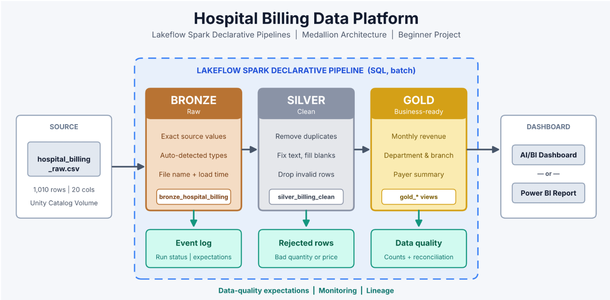
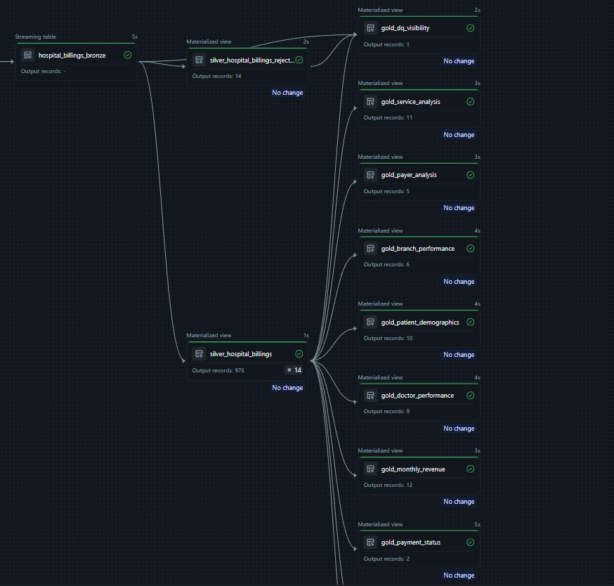

```markdown
# Hospital Billing Analytics Platform: Medallion Architecture with Lakeflow Spark Declarative Pipelines

An end-to-end healthcare billing ETL pipeline on **Azure Databricks**, built with **Lakeflow Spark Declarative Pipelines (SQL)** and the **Medallion Architecture** (Bronze → Silver Clean / Silver Rejected → Gold). It transforms a raw, messy hospital billing CSV into trusted, business-ready analytical datasets, complete with automated data quality expectations, dead-letter rejection tracking, and end-to-end reconciliation.



## Table of Contents
- [Business Problem](#business-problem)
- [Architecture](#architecture)
- [Pipeline Lineage](#pipeline-lineage)
- [Tech Stack](#tech-stack)
- [Dataset](#dataset)
- [Repository Structure](#repository-structure)
- [Layer Details](#layer-details)
- [Data Quality Rules](#data-quality-rules)
- [Reconciliation](#reconciliation)
- [How to Run](#how-to-run)
- [Business Requirements Coverage](#business-requirements-coverage)
- [Key Learnings](#key-learnings)
- [Future Improvements](#future-improvements)

---

## Business Problem
A hospital chain operating across six branches in India exports billing records as CSV files. Reporting on revenue, department utilization, branch performance, and payer balances is slow and unreliable due to common data anomalies:
- Inconsistent casing and whitespace in department, branch, city, and payer fields.
- Missing values in critical fields like patient ID, department, payer type, and billing amounts.
- Duplicate billing rows inflating stated revenue.
- Clinically/financially invalid entries, such as negative unit prices and zero/negative billed quantities.

**Goal:** Build an automated, repeatable Lakeflow pipeline that retains raw ingestion lineage, cleanses and standardizes valid records while isolating bad records into a rejected quarantine table, publishes trusted Gold analytical views, and powers downstream executive dashboards.

---

## Architecture
`hospital_billing_raw.csv` (Unity Catalog Volume) → **Bronze** (raw streaming table) → **Silver Clean & Silver Rejected** (standardized materialized views) → **Gold** (business & DQ materialized views) → **Databricks AI/BI / Power BI**

| Layer | Purpose | Key Actions |
|---|---|---|
| **Bronze** | Source preservation | Stream CSV from Unity Catalog Volume, preserve exact source values, capture metadata (`source_file`, `loaded_at`). |
| **Silver Clean** | Trusted analytical grain | Deduplicate on `bill_id`, trim whitespace, initcap text, impute missing values, enforce expectations (`quantity > 0`, `unit_price >= 0`). |
| **Silver Rejected** | Error quarantine & audit | Capture invalid records (`quantity <= 0` or `unit_price < 0`) with explicit diagnostic `reject_reason`. |
| **Gold** | Business metrics & reconciliation | Aggregate monthly trends, department performance, branch performance, payer summaries, and an audit table validating row balance. |

---

## Pipeline Lineage


| Object | Type | Description |
|---|---|---|
| `bronze_hospital_billing` | Streaming Table | Raw ingested billing lines directly from the volume |
| `silver_billing_clean` | Materialized View | Deduplicated, standardized records passing data quality checks |
| `silver_billing_rejected` | Materialized View | Quarantined rows failing quantity or unit price expectations |
| `gold_monthly_revenue` | Materialized View | Monthly trends across visits, total billed revenue, and insurance collections |
| `gold_department_summary` | Materialized View | Revenue, visit counts, bill counts, and average revenue per visit by department |
| `gold_branch_summary` | Materialized View | Geographic revenue and visit breakdowns across regions, cities, and branches |
| `gold_payer_summary` | Materialized View | Revenue, insurance coverage, and pending balances by payer type |
| `gold_data_quality` | Materialized View | Audit reconciliation comparing Bronze, Clean, Rejected, and Duplicate row counts |

---

## Tech Stack
- **Azure Databricks**
- **Lakeflow Spark Declarative Pipelines (SQL)**
- **Unity Catalog (Volumes, Catalog & Schema Governance)**
- **Delta Lake**
- **Databricks SQL Warehouse / AI/BI Dashboards (or Power BI)**

---

## Dataset
Synthetic hospital billing dataset: **1,010 rows × 20 columns**, covering 330 patient visits across 2025.

> **Grain:** One billing line per row (`bill_id`). While `bill_id` is unique per transaction line, `visit_id` is non-unique because a single patient visit generates multiple charges (e.g., consultation, lab tests, room charges, medication).

---

## Repository Structure

```

├── README.md
├── data/
│   └── hospital_billing_raw.csv   # Raw sample dataset
├── pipeline/
│   ├── bronze/
│   │   └── bronze_hospital_billing.sql
│   ├── silver/
│   │   ├── silver_billing_clean.sql
│   │   └── silver_billing_rejected.sql
│   └── gold/
│       ├── gold_monthly_revenue.sql
│       ├── gold_department_summary.sql
│       ├── gold_branch_summary.sql
│       ├── gold_payer_summary.sql
│       └── gold_data_quality.sql
├── validation/                    # SQL verification & reconciliation scripts
├── docs/                          # Data cleaning rules, project specs, review Q&A
└── images/                        # Pipeline graph, schema models, and dashboard screenshots

```

---

## Layer Details

### Bronze
- Ingested via streaming table reading directly from Unity Catalog Volumes:
  ```sql
  CREATE OR REFRESH STREAMING TABLE bronze_hospital_billing AS
  SELECT 
    *,
    _metadata.file_name AS source_file,
    current_timestamp() AS loaded_at
  FROM STREAM read_files(
    '/Volumes/healthcare_catalog/billing/raw_files/',
    format => 'csv',
    header => true
  );

```

### Silver

* **`silver_billing_clean`**:
* Deduplicated using `DISTINCT`.
* Whitespace stripped and case standardized with `INITCAP(TRIM(...))`.
* Missing department/payer populated with `'Unknown'`.
* Missing `total_amount` derived via `COALESCE(total_amount, quantity * unit_price)`.
* Declarative pipeline expectations drop invalid records:
```sql
CONSTRAINT valid_quantity EXPECT (quantity > 0) ON VIOLATION DROP ROW,
CONSTRAINT valid_unit_price EXPECT (unit_price >= 0) ON VIOLATION DROP ROW

```


* **`silver_billing_rejected`**:
* Filters rows violating business thresholds (`quantity <= 0 OR unit_price < 0`) and tags them with an audit `reject_reason`.


### Gold

* Business-ready aggregations created as materialized views for sub-second BI performance:
* `gold_monthly_revenue`: Trend analysis aggregated by `DATE_TRUNC('MONTH', visit_date)`.
* `gold_department_summary`: Department-level volume, total revenue, and average spend per visit.
* `gold_branch_summary`: Revenue distribution across branches, cities, and regions.
* `gold_payer_summary`: Realized revenue vs. insurance coverage vs. pending balance by payer category.
* `gold_data_quality`: Automated validation summary checking row parity across the pipeline.


---

## Data Quality Rules

| Rule | Problem Scenario | Treatment | SQL Implementation |
| --- | --- | --- | --- |
| **Deduplication** | Identical `bill_id` appearing multiple times | Retain one unique line record | `SELECT DISTINCT ...` |
| **Standardization** | Leading/trailing spaces or mixed casing | Clean text to Title Case | `INITCAP(TRIM(column))` |
| **Completeness** | Missing `department` or `payer_type` | Default to `'Unknown'` without dropping revenue | `COALESCE(column, 'Unknown')` |
| **Imputation** | Missing `total_amount` | Compute from line unit economics | `COALESCE(total_amount, quantity * unit_price)` |
| **Patient Traceability** | Missing `patient_id` | Retained (billing event remains financially valid) | Kept as-is |
| **Business Validity** | `quantity <= 0` or `unit_price < 0` | Drop from clean layer and log into quarantine table | `EXPECT (...) ON VIOLATION DROP ROW` |

---

## Reconciliation

| Metric | Row Count | Formula / Description |
| --- | --- | --- |
| **Bronze Raw Rows** | **1,010** | Total records ingested from source CSV |
| **Duplicates Removed** | **20** | Redundant rows eliminated via `DISTINCT` |
| **Rejected Rows** | **22** | Non-compliant entries (`quantity <= 0` or `unit_price < 0`) |
| **Silver Clean Rows** | **968** | Trusted records promoted to Gold views |

$$\text{Bronze Rows (1,010)} = \text{Clean Rows (968)} + \text{Rejected Rows (22)} + \text{Duplicates Removed (20)}$$

---

## How to Run

1. **Set Up Storage & Schema:**
```sql
CREATE CATALOG IF NOT EXISTS healthcare_catalog;
CREATE SCHEMA IF NOT EXISTS healthcare_catalog.billing;
CREATE VOLUME IF NOT EXISTS healthcare_catalog.billing.raw_files;

```


2. **Upload Dataset:** Upload `hospital_billing_raw.csv` into the volume via Databricks Catalog Explorer.
3. **Configure Lakeflow Pipeline:**
* Create a new **Lakeflow Spark Declarative Pipeline** in Databricks.
* Point the pipeline source to the repository SQL files (`pipeline/`).
* Set the default catalog to `healthcare_catalog` and schema to `billing`.


4. **Deploy & Refresh:** Click **Start** (or **Full Refresh**) to execute the pipeline end-to-end.
5. **Connect Dashboard:** Connect Databricks AI/BI (or Power BI via the SQL Warehouse endpoint) to the `gold_*` materialized views.

---

## Business Requirements Coverage

| ID | Requirement | Implementation / Target View | Status |
| --- | --- | --- | --- |
| **BR-01** | Monthly revenue trends | `gold_monthly_revenue` | Completed |
| **BR-02** | Department performance | `gold_department_summary` | Completed |
| **BR-03** | Branch & regional revenue | `gold_branch_summary` | Completed |
| **BR-04** | Payer & insurance analysis | `gold_payer_summary` | Completed |
| **BR-05** | Data quality visibility | `gold_data_quality` | Completed |
| **BR-06** | Mathematical row reconciliation | `gold_data_quality` | Completed |
| **BR-07** | Pipeline repeatability | Declarative pipeline configuration | Completed |
| **BR-08** | Executive reporting dashboard | Databricks AI/BI / Power BI Report (3 Pages) | Completed |

---

## Key Learnings

* **Bronze Traceability:** Retaining exact raw records with metadata allows seamless reprocessing and auditing without re-requesting source files.
* **Handling Invalid Data:** Using `EXPECT ... ON VIOLATION DROP ROW` alongside a dedicated `silver_billing_rejected` table ensures reporting integrity without losing sight of bad source data.
* **Granularity & Uniqueness:** Identifying that `bill_id` (transaction grain) is the true unique key rather than `visit_id` (parent visit event) prevented accidental loss of legitimate multi-charge billings.
* **Reconciliation Rigor:** Mathematical validation ($\text{Bronze} = \text{Clean} + \text{Rejected} + \text{Duplicates}$) ensures complete transparency before business sign-off.

---

## Future Improvements

* Automate real-time or daily file ingestion using Databricks Auto Loader (`cloudFiles`).
* Transition to a star schema design with dedicated dimension tables (`dim_patient`, `dim_doctor`, `dim_branch`).
* Configure automated email/Slack alerts using Databricks Lakehouse Monitoring for quality threshold violations.
* Implement SCD Type 2 tracking for changing patient demographic or insurance provider histories.

---

## License

MIT (see `LICENSE`)

```

```
