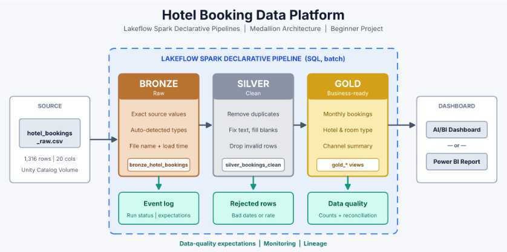

# Architecture and Pipeline Design

## 1. End-to-end architecture



The project uses a Bronze → Silver → Gold pattern.

### Bronze — raw ingestion

Create a streaming table from files in a Unity Catalog Volume. Preserve source columns and add ingestion metadata such as source file name and load timestamp.

Target table:

- `bronze_hotel_bookings`

Example source location from the brief:

```text
/Volumes/hospitality_catalog/bookings/raw_files/
```

Example SQL pattern from the brief:

```sql
CREATE OR REFRESH STREAMING TABLE bronze_hotel_bookings AS
SELECT
    *,
    _metadata.file_name AS source_file,
    current_timestamp() AS loaded_at
FROM STREAM read_files(
    '/Volumes/hospitality_catalog/bookings/raw_files/',
    format => 'csv',
    header => true
);
```

### Silver — cleaning and validation

Silver contains two outputs:

- `silver_bookings_clean`: valid, standardised bookings, including completed and cancelled bookings.
- `silver_bookings_rejected`: records that fail critical validity checks, with a rejection reason.

Cleaning includes deduplication, text standardisation, filling selected missing values, and validating stay dates and room rates.


### Gold — business summaries

Gold contains business-facing aggregates and a data-quality summary.

| Table | Grouping |
|---|---|
| `gold_monthly_bookings` | Month of check-in |
| `gold_hotel_summary` | Region, city, hotel |
| `gold_room_type_summary` | Room type |
| `gold_channel_summary` | Booking channel |
| `gold_data_quality` | Pipeline quality totals |

## 2. Example Gold monthly aggregation

The brief provides this starter SQL pattern:

```sql
CREATE OR REFRESH MATERIALIZED VIEW gold_monthly_bookings AS
SELECT
    DATE_TRUNC('MONTH', check_in_date) AS stay_month,
    COUNT(*) AS bookings,
    SUM(CASE WHEN booking_status = 'Cancelled' THEN 1 ELSE 0 END)
        AS cancelled_bookings,
    SUM(CASE WHEN booking_status = 'Completed' THEN nights ELSE 0 END)
        AS room_nights,
    SUM(
        CASE WHEN booking_status = 'Completed'
             THEN total_amount - discount_amount
             ELSE 0
        END
    ) AS net_revenue
FROM silver_bookings_clean
GROUP BY DATE_TRUNC('MONTH', check_in_date);
```

## 3. Suggested implementation sequence

1. Create or select a catalog.
2. Create the project schema and Volume.
3. Upload the source CSV.
4. Create the Lakeflow pipeline with the required default catalog and schema.
5. Add the Bronze streaming table.
6. Add Silver clean and rejected materialized views.
7. Add Gold business summaries and quality metrics.
8. Run the pipeline and inspect the event log and data preview.
9. Validate the reconciliation equation.
10. Connect the Gold tables to the selected dashboard tool.

## 4. Example catalog setup

```sql
CREATE CATALOG IF NOT EXISTS hospitality_catalog;
CREATE SCHEMA IF NOT EXISTS hospitality_catalog.bookings;
CREATE VOLUME IF NOT EXISTS hospitality_catalog.bookings.raw_files;
```

Use a different catalog or schema if your workspace does not allow creation of these names. If you change them, update the pipeline and dashboard references consistently.

## 5. Design decisions

- Bronze preserves source information for traceability.
- Silver separates valid records from records that fail critical checks.
- Cancelled bookings are not rejected because cancellation is a legitimate business status.
- Gold applies business rules consistently so cancelled bookings do not inflate revenue or room-night metrics.
- The dashboard reads from Gold rather than repeating transformation logic in the reporting layer.
