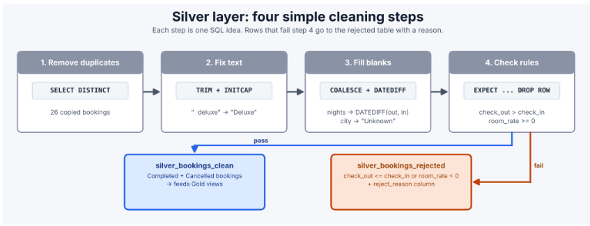

# Data Cleaning, Quality Checks and Reconciliation

## 1. Known source-data issues

The project brief identifies the following planted issues:

- Duplicate booking IDs.
- Extra spaces and inconsistent capitalisation in city, room type, booking channel and meal plan.
- Missing city, booking channel, guest ID, nights and total amount.
- Check-out dates on or before check-in dates.
- Negative room rates.

## 2. Silver cleaning rules



| Issue | Treatment |
|---|---|
| Duplicate `booking_id` | Keep one copy |
| Leading/trailing spaces and mixed case | Apply `TRIM` and `INITCAP` to relevant text |
| Blank city or channel | Standardise blanks and replace missing values with `Unknown` |
| Missing nights | Calculate using `DATEDIFF(check_out_date, check_in_date)` |
| Missing total amount | Calculate from nights × room rate |
| Missing guest rating or guest ID | Keep as NULL |
| Check-out on/before check-in | Reject from clean output and record a reason |
| Negative room rate | Reject from clean output and record a reason |
| Cancelled booking | Keep in clean Silver; exclude from Gold revenue and room nights |

### Example standardisation expressions

```sql
INITCAP(TRIM(city))
INITCAP(TRIM(room_type))
INITCAP(TRIM(booking_channel))
INITCAP(TRIM(meal_plan))
```

For blank strings, normalise empty values to NULL before applying `COALESCE`. `COALESCE` alone does not replace an empty string.

## 3. Rejected records

The rejected output should retain the original record fields and include a `reject_reason` column. The brief identifies two rejection conditions:

```sql
check_out_date <= check_in_date
OR room_rate < 0
```

If a row violates more than one rule, consider recording all applicable reasons rather than only the first one. Keep the rejection logic consistent with the pipeline's expectations.

## 4. Data-quality summary

The brief proposes `gold_data_quality` to report:

- Bronze row count.
- Duplicate row count.
- Invalid date row count.
- Missing city count.
- Other missing-field counts, including channel, amount and nights.
- Negative-rate row count.
- Clean row count.
- Rejected row count.

## 5. Reconciliation

The project acceptance criterion is:

```text
bronze_rows = clean_rows + rejected_rows + duplicate_rows
```

This equation assumes the three categories are mutually exclusive and that the counts are calculated at the same record grain. Design the deduplication and rejection sequence carefully so that a row is not counted in more than one category.

## 6. Reference checks from the brief

| Check | Reference value |
|---|---:|
| Bronze input rows | 1,316 |
| Clean Silver bookings | 1,269 |

The PDF gives 1,269 as the expected clean-booking count for its reference solution. Your actual output may differ if your source file or implementation differs. Record the actual counts from your own pipeline run.

## 7. Business metric guardrails

- Count completed and cancelled bookings in booking totals when the metric is intended to represent all clean bookings.
- Count room nights only for completed bookings.
- Calculate net revenue only for completed bookings.
- Do not interpret cancelled bookings as data-quality failures.
- Keep missing ratings NULL so averages ignore missing values rather than treating them as zero.
