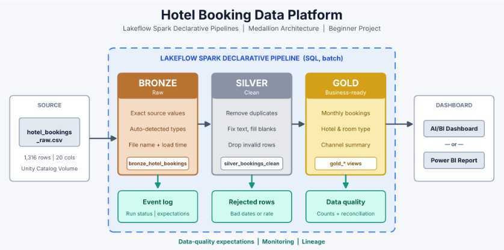
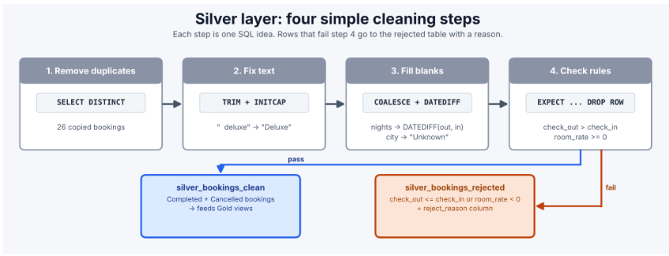

# Hotel Booking Analytics Platform | Medallion Architecture

An end-to-end beginner-friendly data engineering project that transforms a synthetic hotel-booking CSV into trusted analytics tables using **Databricks Lakeflow Spark Declarative Pipelines**, **Databricks SQL**, and the **Medallion Architecture**.

> **Project status:** Documentation starter based on the supplied project brief. Update the implementation-specific details and screenshots after running your own Databricks pipeline.

## Project overview

A hotel group needs reliable reporting for bookings, cancellations, room nights, revenue, hotels, room types, and booking channels. The source CSV contains common data-quality issues such as duplicate booking IDs, inconsistent text, missing values, invalid stay dates, and negative room rates.

This project describes a repeatable pipeline that preserves the source data, cleans and validates records, creates business-ready Gold summaries, and exposes the results in a dashboard.

## Architecture



The pipeline follows three layers:

| Layer | Responsibility | Main outputs |
|---|---|---|
| Bronze | Preserve source records and ingestion metadata | `bronze_hotel_bookings` |
| Silver | Standardise values, remove duplicate records, separate invalid records | `silver_bookings_clean`, `silver_bookings_rejected` |
| Gold | Publish business-level aggregations and data-quality metrics | Monthly, hotel, room-type, channel and quality summaries |

See [Architecture and pipeline design](Docs/architecture.md) for details.

## Dataset

The project brief describes a synthetic file named `hotel_bookings_raw.csv` containing **1,316 rows and 20 columns** covering hotel stays in 2025. It contains no real guest data.

The dataset is expected to be uploaded to a Unity Catalog Volume. The brief refers to this example path:

```text
/Volumes/hospitality_catalog/bookings/raw_files/
```

The dataset itself is not included in this documentation package. Add the CSV to your repository only if you have permission to redistribute it; otherwise, provide download/setup instructions.

## Business metrics

- Total bookings
- Cancelled bookings and cancellation rate
- Completed room nights
- Net revenue from completed bookings
- Average Daily Rate (ADR)
- Hotel, city, region, room-type and booking-channel performance
- Data-quality issue counts and reconciliation

**Business rules:** Cancelled bookings remain valid business events and are retained in Silver. They must not contribute to net revenue or room nights. Net revenue is `total_amount - discount_amount` for completed bookings only.

## Repository structure

```text
Hotel Booking Medallion Lakeflow/
├── README.md
├── docs/
│   ├── architecture.md
│   ├── data_dictionary.md
│   ├── data_quality.md
│   └── dashboard.md
└── images/
    ├── medallion_architecture.png
    ├── silver_cleaning_workflow.png
    ├── dashboard_layer.png
    └── dashboard_overview_example.png
```

## Implementation workflow

1. Create a catalog, schema, and Unity Catalog Volume.
2. Upload `hotel_bookings_raw.csv` to the Volume.
3. Create a Lakeflow Spark Declarative Pipeline and ingest the source into Bronze.
4. Build Silver clean and rejected datasets using the documented cleaning rules.
5. Create the four Gold business summary tables and the data-quality table.
6. Validate row counts and reconciliation.
7. Build a three-page dashboard in **one** tool: Databricks AI/BI or Power BI.

## Data Cleaning Rules
Silver cleaning is done in four simple steps. Each step uses one SQL idea.



## Gold tables described in the brief

| Table | Grain |
|---|---|
| `gold_monthly_bookings` | Stay month |
| `gold_hotel_summary` | Region, city, hotel |
| `gold_room_type_summary` | Room type |
| `gold_channel_summary` | Booking channel |
| `gold_data_quality` | Pipeline-level quality summary |

## Documentation

- [Architecture and pipeline design](Docs/architecture.md)
- [Dataset and column dictionary](Docs/data_dictionary.md)
- [Data cleaning, quality checks and reconciliation](Docs/data_quality.md)
- [Dashboard requirements and build guide](Docs/dashboard.md)

## Important implementation notes

- The SQL snippets in the source brief are starter examples; complete and test them against the actual CSV schema before running the pipeline.
- Confirm the source data types and date parsing behaviour in Databricks.
- The PDF's example expected clean-booking count is **1,269**. Treat this as a reference check from the brief, not as a result independently reproduced by this repository.
- Do not claim that the pipeline or dashboard has been executed unless you have run it and captured your own results.

## Tools and concepts

- Databricks
- Lakeflow Spark Declarative Pipelines
- Databricks SQL
- Unity Catalog Volumes
- Medallion Architecture (Bronze, Silver, Gold)
- Data quality and reconciliation
- Databricks AI/BI or Power BI

## Acknowledgement

Project design, dataset description, business rules and example figures are based on the supplied *Hotel Booking Analytics Platform* project brief.
